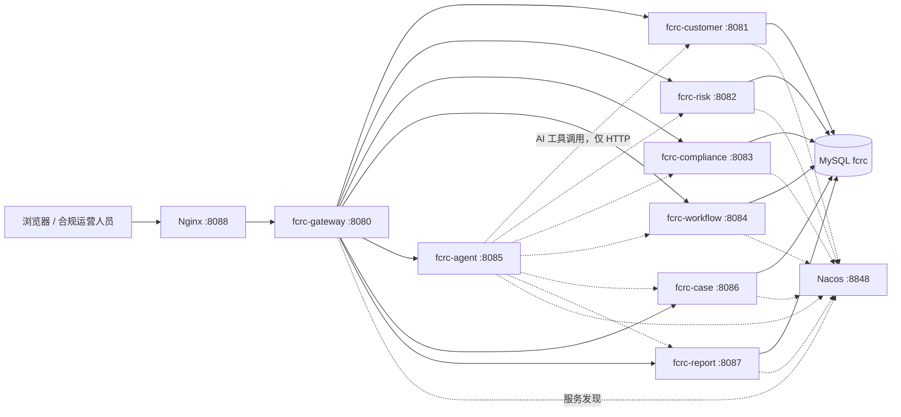

# FCRC · 金融合规与风险控制平台

> 一个面向企业落地、同时面向教学的金融合规/反洗钱（AML）/KYC 微服务项目。  
> 核心演示：**Spring AI Alibaba Graph 负责可暂停、可恢复、可审计的审批编排；AgentScope Java 负责有权限边界、有工作区、有记忆的合规 Copilot。**

---

## 1. 这个项目解决什么问题

银行、支付机构、券商在客户开户与持续尽调中，需要同时完成：

- 客户身份识别（KYC）与受益所有人识别；
- 风险评分与风险等级划分；
- 制裁名单、负面舆情、PEP 等合规筛查；
- 高风险情形的**人工复核**；
- 案件流转、监管报告生成与留存；
- 全过程可追溯、可解释、可审计。

FCRC 把这些能力拆成 7 个业务/网关服务和 1 个 AI 服务，通过 Nacos 注册发现、MySQL 持久化、Docker Compose 部署。

**最重要的合规红线：AI 只做查询、分析、建议和流程启动，不参与任何人工审批/复核决定。**

---

## 2. 功能总览

| 能力 | 说明 |
| --- | --- |
| 客户与 KYC | 客户建档、查询、KYC 状态、开户状态、PEP 标识、PII 脱敏 |
| 风险评分 | 0-100 分、LOW/MEDIUM/HIGH/CRITICAL、可解释风险因子 |
| 合规筛查 | KYC/AML/制裁/负面舆情，PASS/REVIEW/REJECT，发现项与建议 |
| 联合工作流 | Graph 并行编排风险 + 合规，自动审批或转人工复核，数据库 checkpoint |
| 人工复核 | 真人在工作流页面提交 `APPROVED/REJECTED`，服务从 checkpoint 恢复 |
| 合规案件 | 自动创建复核案件、分配、状态流转、不可变备注 |
| 监管报告 | 客户风险报告、SAR、CTR、周期报告，定稿/报送/CSV 导出 |
| AI Copilot | 工具调用、SSE 流式、工作区、长期记忆、上下文压缩、技能、Plan Mode、子智能体 |
| 驾驶舱 | 客户、工作流、案件、报告、AI 对话一屏展示 |

---

## 3. 系统架构



### 3.1 模块

| 模块 | 端口 | 职责 |
| --- | --- | --- |
| `fcrc-common` | - | 统一响应、分页、错误码、领域 DTO、异常处理 |
| `fcrc-service-parent` | - | 业务服务共享依赖与构建配置 |
| `fcrc-gateway` | 8080 | 统一入口、路由、CORS、静态驾驶舱 |
| `fcrc-customer` | 8081 | 客户主数据、KYC/开户状态、内部画像 |
| `fcrc-risk` | 8082 | 风险评分与因子解释 |
| `fcrc-compliance` | 8083 | 合规筛查与发现项 |
| `fcrc-workflow` | 8084 | Graph 编排、checkpoint、人工复核、事件 |
| `fcrc-agent` | 8085 | AgentScope Copilot、工具、权限、记忆、工作区 |
| `fcrc-case` | 8086 | 合规案件、备注、SLA |
| `fcrc-report` | 8087 | 监管报告、CSV |
| `deploy/fcrc-web` | 8088 | Nginx 静态驾驶舱 + API 反向代理 |

> 端口 8088 是 Docker 拓扑中的 Nginx；本地开发时驾驶舱由网关 8080 直接托管。

---

## 4. 技术栈

- Java 21、Spring Boot 3.5.16
- Spring Cloud 2025.0.0、Spring Cloud Alibaba 2025.0.0.0
- Spring AI Alibaba Graph 1.1.2.4-security-fix
- AgentScope Java 2.0.4
- MySQL 8.4（Docker）、H2（本地）
- Nacos 3.0.3（Docker 服务发现）
- Nginx 1.27（前端与反向代理）
- 原生 HTML/CSS/JS 驾驶舱，无前端构建链
- 无 Lombok，全部显式代码与中文教学注释

---

## 5. 本地快速启动

### 5.1 前置条件

- JDK 21+
- Maven 3.9+
- 不需要 Docker、MySQL、Nacos、API Key

本地 profile 使用 H2 文件数据库，关闭 Nacos，AI 默认使用确定性 Mock 模型。

### 5.2 构建

```bash
cd fcrc
mvn -q clean install -DskipTests
```

### 5.3 按顺序启动（8 个终端）

```bash
mvn -q -pl fcrc-customer   spring-boot:run
mvn -q -pl fcrc-risk       spring-boot:run
mvn -q -pl fcrc-compliance spring-boot:run
mvn -q -pl fcrc-case       spring-boot:run
mvn -q -pl fcrc-report     spring-boot:run
mvn -q -pl fcrc-workflow   spring-boot:run
mvn -q -pl fcrc-agent      spring-boot:run
mvn -q -pl fcrc-gateway    spring-boot:run
```

打开 <http://localhost:8080> 进入驾驶舱。

### 5.4 验证

```bash
curl http://localhost:8080/api/agent/health
curl http://localhost:8080/api/customers/stats
curl http://localhost:8080/api/workflows/stats
```

AI 对话：

```bash
curl -X POST http://localhost:8080/api/agent/chat \
  -H "Content-Type: application/json" \
  -d '{"message":"评估客户 1 的风险","userId":"demo-user","sessionId":"main"}'
```

### 5.5 启动全部服务的一键脚本（可选）

如果使用 PowerShell，可在每个模块目录分别执行上面的 Maven 命令；更推荐使用 Docker Compose 一键启动，避免 8 个终端。

---

## 6. Docker 部署

```bash
cd deploy
cp .env.example .env
# 修改 MySQL 密码；如需真实大模型，填写 DASHSCOPE_API_KEY 并设置 FCRC_AGENT_MODEL=dashscope
docker compose up -d --build
```

访问：

- 驾驶舱：<http://服务器IP:8088>
- 网关：<http://服务器IP:8080>
- Nacos 控制台：<http://服务器IP:8849/nacos>

详细步骤、备份、回滚、故障排查见 [docs/06-deployment.md](docs/06-deployment.md)。

---

## 7. AI 模型切换

默认 `mock`：不访问外网、不需要 Key，按关键词确定性地选择工具，适合演示与自动化测试。

切换真实模型：

```bash
export FCRC_AGENT_MODEL=dashscope
export DASHSCOPE_API_KEY=sk-xxxx
export FCRC_DASHSCOPE_MODEL=qwen-plus
```

Docker 环境修改 `deploy/.env` 后重启 `fcrc-agent`。

---

## 8. 演示数据

本地启动时自动写入：

| 客户号 | 姓名 | 场景 |
| --- | --- | --- |
| CUS-DEMO-0001 | 张伟 | 低风险、可自动通过 |
| CUS-DEMO-0002 | 李娜 | 中风险、需人工复核 |
| CUS-DEMO-0003 | 王强 | PEP、新加坡、需人工复核 |
| CUS-DEMO-0004 | 陈静 | 伊朗、高风险、拒绝 |
| CUS-DEMO-0005 | 华星科技有限公司 | 企业客户、跨境 |
| CUS-DEMO-0006 | 北辰资本控股 | 开曼、PEP、制裁风险 |

Docker 首次初始化还会写入两条已完成工作流，便于驾驶舱直接展示。

关闭演示数据：`FCRC_DEMO_DATA_ENABLED=false`。

---

## 9. 核心安全设计

- AI 工具默认拒绝，显式白名单；
- `execute`、`write_file`、`edit_file`、`web_search`、`web_fetch` 明确拒绝；
- 人工复核接口**没有注册为 AI 工具**，形成第二道防线；
- 工作流在 `manual_review` 前 `interruptBefore`，必须由真人提交复核意见；
- 所有 AI 结论必须来自工具返回，禁止编造；
- PII 在对外 API 中脱敏，AI 工具只读取必要字段。

详见 [docs/04-security-and-hitl.md](docs/04-security-and-hitl.md)。

---

## 10. 测试

```bash
mvn -q test
mvn -q package
```

测试覆盖：

- 客户/风险/合规/案件/报告服务 API 与业务规则；
- 工作流自动通过、人工复核暂停、批准/拒绝恢复；
- Agent 装配、会话稳定性、Mock 模型工具选择；
- 网关 7 条路由加载。

---

## 11. 文档索引

| 文档 | 内容 |
| --- | --- |
| [docs/01-architecture.md](docs/01-architecture.md) | 架构、时序、数据模型、设计取舍 |
| [docs/02-requirements.md](docs/02-requirements.md) | 角色、功能/非功能需求、验收标准 |
| [docs/03-api.md](docs/03-api.md) | 全部 REST/SSE 接口与示例 |
| [docs/04-security-and-hitl.md](docs/04-security-and-hitl.md) | 权限、威胁模型、人工复核边界 |
| [docs/05-teaching-guide.md](docs/05-teaching-guide.md) | Graph/AgentScope 教学地图与实验 |
| [docs/06-deployment.md](docs/06-deployment.md) | Ubuntu + Docker 部署、备份、回滚 |
| [deploy/README.md](deploy/README.md) | 部署目录说明与常用命令 |

---

## 12. 已知边界

本项目是**可运行的教学级企业样板**，不是可直接投产的金融系统。投产前至少需要补齐：

- 统一身份认证、RBAC、网关鉴权、mTLS；
- 字段级加密、密钥管理、数据分级与脱敏审计；
- 分布式锁、Outbox/Saga、跨服务事务一致性；
- 真实制裁名单/负面舆情供应商接入；
- 模型评测、提示词注入防护、输出内容审核；
- 高可用 Nacos/MySQL、监控告警、链路追踪、容量规划。

这些边界在文档中都有对应的扩展建议。
