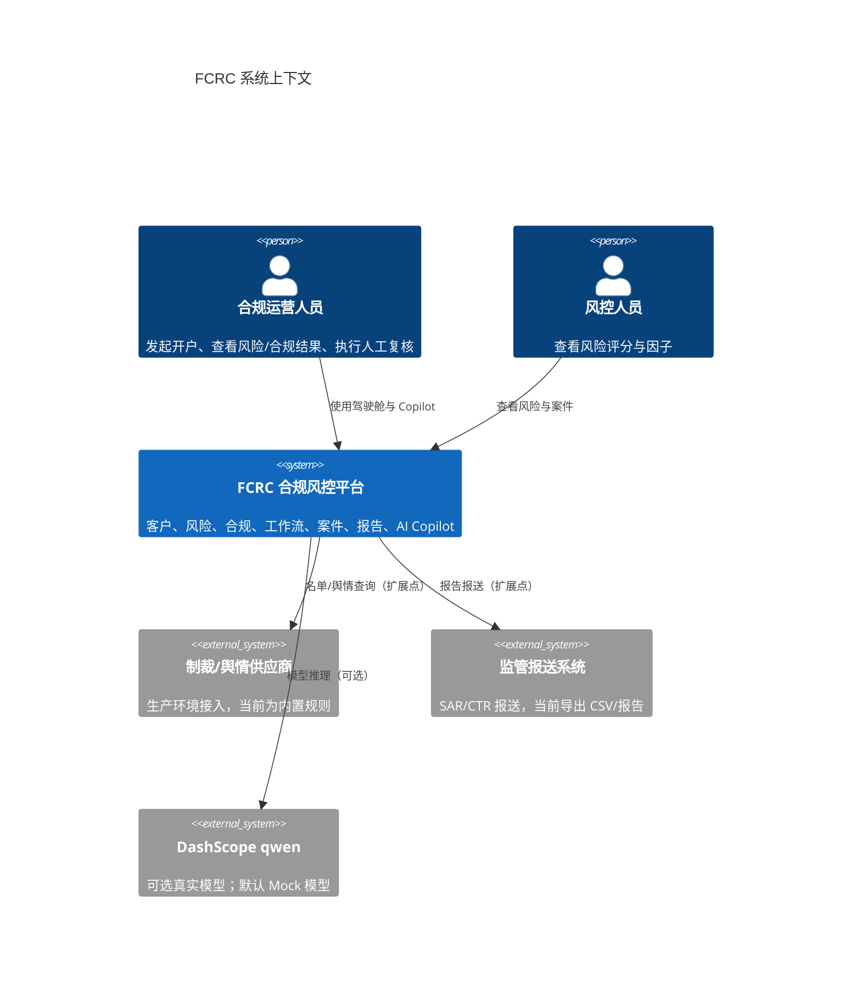
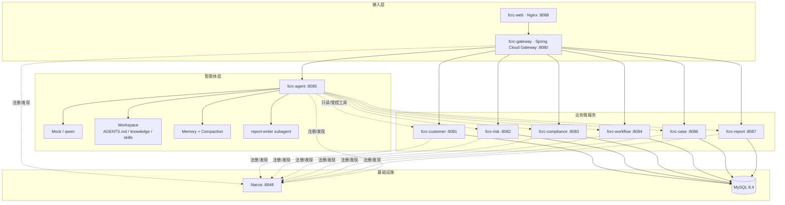
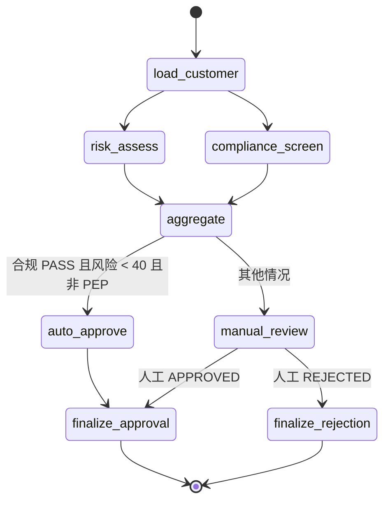
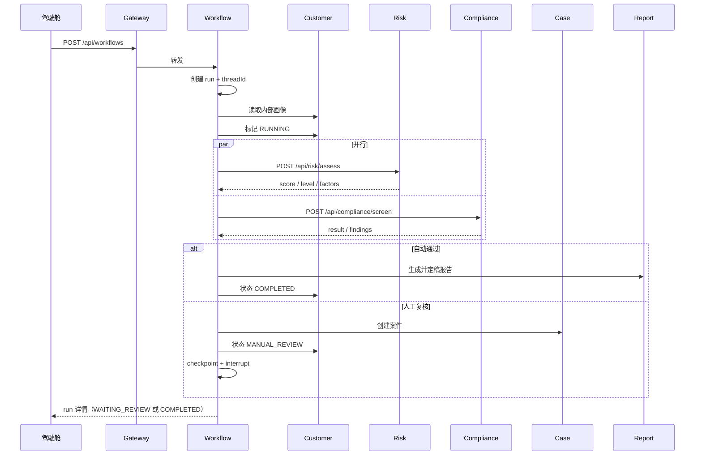
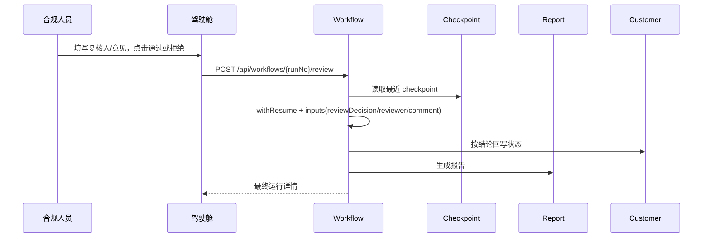
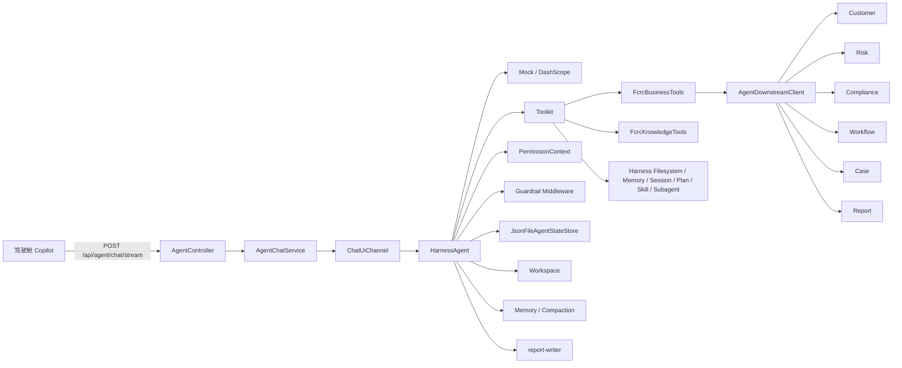
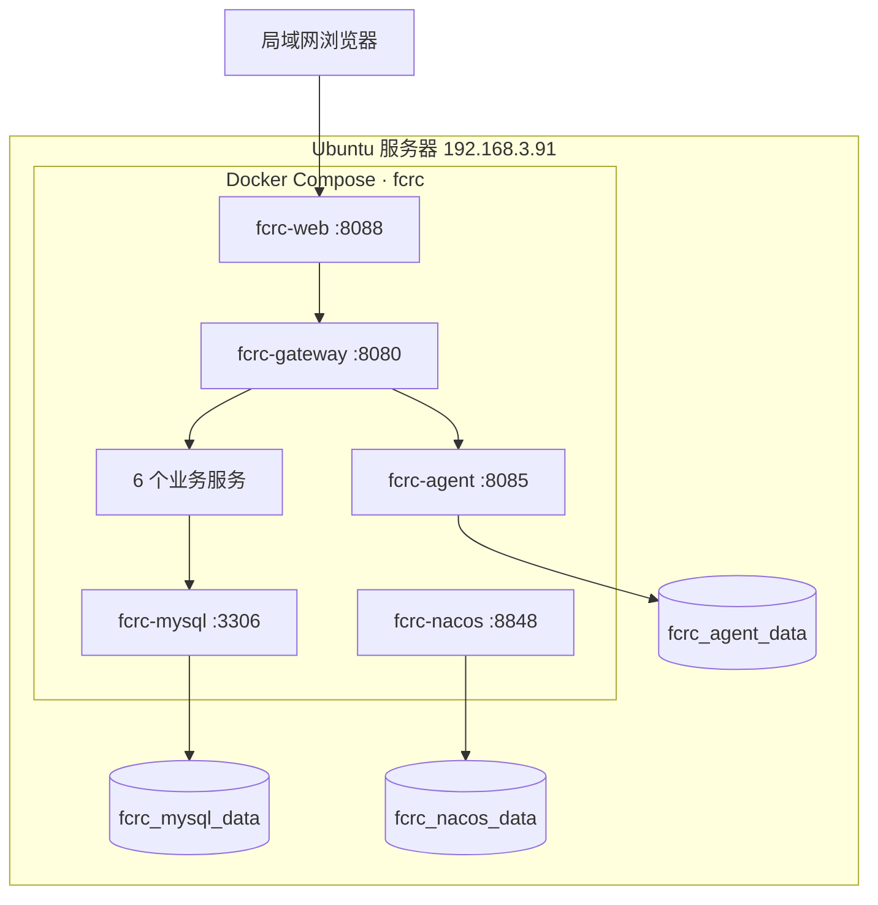

# 01 · 架构设计

## 1. 设计目标

FCRC 的目标不是“再写一个 CRUD 系统”，而是把金融合规场景里最容易出问题的三件事讲清楚并做出来：

1. **审批流程必须有状态、可暂停、可恢复、可审计**，不能写成一段不可观测的 `if/else`；
2. **AI 只能增强人的判断，不能替代人的审批**，因此权限、工具、人工复核边界必须工程化；
3. **微服务拆分要围绕业务边界**，而不是为了拆而拆。

### 1.1 非目标

- 不实现真实银行核心账务；
- 不接入真实制裁名单/征信/负面舆情供应商；
- 不实现完整 IAM、SSO、mTLS；
- 不做前端工程化（驾驶舱使用原生 HTML/CSS/JS，降低演示门槛）。

这些非目标在 [04-security-and-hitl.md](04-security-and-hitl.md) 与 [06-deployment.md](06-deployment.md) 中给出投产扩展建议。

---

## 2. 系统上下文



---

## 3. 逻辑架构



### 3.1 分层职责

| 层 | 职责 | 不做什么 |
| --- | --- | --- |
| Nginx | 静态资源、反向代理、SSE 不缓冲 | 不写业务逻辑 |
| Gateway | 路由、CORS、统一入口 | 不做审批决策 |
| 业务服务 | 领域规则、持久化、对外 API | 不直接调用模型 |
| Agent | 对话、工具编排、权限、记忆 | 不直接访问数据库 |
| Graph | 审批状态机、并行、checkpoint、HITL | 不负责 UI 展示 |
| MySQL | 业务数据、事件、checkpoint | 不做跨服务强一致事务 |

### 3.2 为什么 AI 不直接连数据库

- 绕过业务校验：风险/合规规则在服务层，AI 直读会拿到“未经过规则计算”的原数据；
- 绕过权限：数据库账号一旦给 AI，权限边界就消失；
- 审计割裂：人工操作与 AI 操作必须落在同一套业务 API 上，才能统一审计；
- 演进耦合：表结构变化会直接破坏 AI，而 API 是稳定契约。

因此 `AgentDownstreamClient` 只通过 HTTP 调用业务服务，并且**只注册了允许的只读/启动类接口**。

---

## 4. 开户审批工作流

### 4.1 图结构



对应代码：`fcrc-workflow/src/main/java/com/fcrc/workflow/graph/OnboardingGraphConfiguration.java`。

### 4.2 关键设计点

| 设计点 | 实现 | 为什么 |
| --- | --- | --- |
| 并行扇出/扇入 | `addEdge(LOAD_CUSTOMER, List.of(RISK, COMPLIANCE))` + `addEdge(List.of(...), AGGREGATE)` | 风险与合规互不依赖，可并发，缩短耗时 |
| 分支边界 | 合规节点传入 `riskLevel=null` | 并行节点不能读取另一个分支尚未写入的值 |
| 决策与执行分离 | `aggregate` 只写 `preliminaryDecision`，收尾节点才回写客户 | 失败重试时幂等边界更清晰 |
| 人工中断 | `interruptBefore("manual_review")` | 暂停不是线程阻塞，而是落库后结束调用 |
| 检查点 | `JpaCheckpointSaver` + `workflow_checkpoints` | 服务重启/扩容后仍可恢复 |
| 事件 | `WorkflowEventRecorder` 包裹每个节点 | 开始/完成/失败都进入时间线，可 SSE 推送 |
| 长事务规避 | Service 方法不加 `@Transactional` | 图执行跨多次远程调用，长事务会占连接且不跨线程传播 |

### 4.3 自动审批规则

```text
AUTO_APPROVE =
    complianceResult == PASS
    AND riskScore < 40
    AND customer.pep == false
```

其他情况一律：

1. 创建合规案件（`fcrc-case`）；
2. 客户开户状态改为 `MANUAL_REVIEW`；
3. 图在 `manual_review` 前暂停；
4. 等待真人通过 `/api/workflows/{runNo}/review` 提交意见；
5. 用 `RunnableConfig.withResume()` 从 checkpoint 恢复；
6. 批准 → 生成报告、客户状态 `COMPLETED`；拒绝 → 生成报告、客户状态 `REJECTED`。

### 4.4 启动时序



### 4.5 人工复核时序



> AI 没有 `/review` 工具，也没有 `reviewer` 权限。即使模型被提示词注入，也无法提交人工复核。

---

## 5. AI 架构

### 5.1 组件图



### 5.2 会话隔离

`ChatUiChannel.send(SendOptions.of(userId, sessionId), message)`：

- `userId` 决定“谁”；
- `sessionId` 决定“哪段对话”；
- 二者组合映射为稳定的会话键；
- `JsonFileAgentStateStore` 把状态落到 `FCRC_AGENT_STATE`；
- 不同用户、不同 session 永不共享上下文。

### 5.3 权限模型

```text
PermissionMode.DEFAULT
  ├─ 显式 ALLOW：业务工具、只读文件、记忆、会话、计划、技能、子智能体
  └─ 显式 DENY：execute、write_file、edit_file、web_search、web_fetch
```

细节见 [04-security-and-hitl.md](04-security-and-hitl.md)。

### 5.4 工作区

```text
data/agent-workspace/
├── AGENTS.md              # 角色、输出规范、工具使用顺序
├── MEMORY.md              # 长期记忆摘要
├── README.md              # 工作区说明
├── knowledge/             # 合规制度库，检索后引用
│   ├── KNOWLEDGE.md
│   ├── high-risk-countries.md
│   ├── pep-due-diligence.md
│   └── suspicious-transaction.md
├── skills/
│   ├── kyc-review/SKILL.md
│   └── sanctions-escalation/SKILL.md
├── plans/                 # Plan Mode 输出
└── memory/                # 记忆账本
```

工作区初始化是幂等的：已存在文件不覆盖，避免重启覆盖人工维护的制度。

---

## 6. 数据架构

### 6.1 表归属

| 表 | 归属服务 | 说明 |
| --- | --- | --- |
| `customers` | customer | 客户主数据、KYC/开户状态 |
| `risk_assessments` | risk | 评分、等级、风险因子 JSON |
| `compliance_screenings` | compliance | 筛查结果、发现项 JSON |
| `compliance_cases` | case | 复核案件 |
| `case_notes` | case | 不可变备注 |
| `regulatory_reports` | report | 监管报告 |
| `workflow_runs` | workflow | 运行聚合 |
| `workflow_events` | workflow | 事件时间线 |
| `workflow_checkpoints` | workflow | Graph 状态快照 |

### 6.2 为什么共享一个库

教学项目为了降低部署复杂度，使用一个 MySQL 实例和一个 `fcrc` 库。服务之间**不做数据库外键**，只通过 API 协作；表归属清晰，后续可平滑拆库。

生产建议：

- 按服务拆 schema/实例；
- 跨服务一致性使用 Outbox + 消息队列；
- 工作流 checkpoint 可换 Redis/PostgreSQL/对象存储；
- 报表读模型可独立到分析库。

### 6.3 一致性策略

| 场景 | 当前策略 | 生产增强 |
| --- | --- | --- |
| 风险/合规并行结果 | Graph 状态汇聚 | 保持 |
| 客户状态回写 | finalize 节点顺序调用 | Outbox + 重试 |
| 案件创建 | aggregate 内同步调用 | 幂等键 + 补偿 |
| 报告生成 | finalize 内同步调用 | 异步任务 + 状态机 |
| 人工复核重复提交 | 状态检查 + `@Version` | 分布式锁 |

---

## 7. 部署架构



- 只有 8088（前端）、8080（网关）、8848/8849（Nacos）、3306（仅本机）暴露；
- 业务服务不映射宿主端口，必须经网关访问；
- Agent 数据使用命名卷，容器重建不丢工作区/会话；
- MySQL 初始化脚本见 `deploy/mysql/init/`。

---

## 8. 可观测性

当前已具备：

- Actuator health/metrics；
- 工作流事件表 + SSE 时间线；
- Agent 护栏中间件记录用户/会话/工具/耗时；
- 统一 `ApiResponse` 错误码；
- Docker healthcheck + `deploy/scripts/health-check.sh`。

生产建议：

- OpenTelemetry 链路追踪（gateway → service → DB）；
- Prometheus + Grafana；
- 结构化 JSON 日志与敏感字段脱敏；
- AI 调用单独审计表：模型、token、工具、耗时、结果摘要；
- 告警：人工复核积压、工作流失败率、下游超时、模型错误率。

---

## 9. 关键取舍

| 取舍 | 选择 | 代价 | 收益 |
| --- | --- | --- | --- |
| 本地数据库 | H2 文件 | 与 MySQL 有差异 | 零依赖启动 |
| 服务发现 | 本地关闭 / Docker Nacos | 两套配置 | 演示简单，生产可扩展 |
| AI 模型 | 默认 Mock | 不是真智能 | 无 Key 可跑测试与演示 |
| 前端 | 原生 JS | 无组件化 | 无构建链、易审阅 |
| 数据库 | 单库多表 | 隔离弱 | 部署简单，边界仍清晰 |
| 人工复核 | Graph 中断 | 需要恢复逻辑 | 真正的人在环路 |
| 认证 | 网关注入 userId（简化） | 不满足生产 | 聚焦 AI 编排教学 |

---

## 10. 扩展路线

1. **认证与授权**：OIDC + RBAC + ABAC，网关注入可信身份；
2. **名单服务**：接入 Dow Jones/Refinitiv/本地 OFAC 清单；
3. **规则中心**：把自动审批阈值、风险权重外置到配置中心；
4. **事件驱动**：Kafka + Outbox，解耦案件/报告；
5. **AI 评测**：黄金问题集、工具调用准确率、幻觉率、提示词注入测试；
6. **多租户**：tenantId 贯穿表、会话、工作区与权限；
7. **可观测**：OTel + Prometheus + Grafana + 审计检索。
