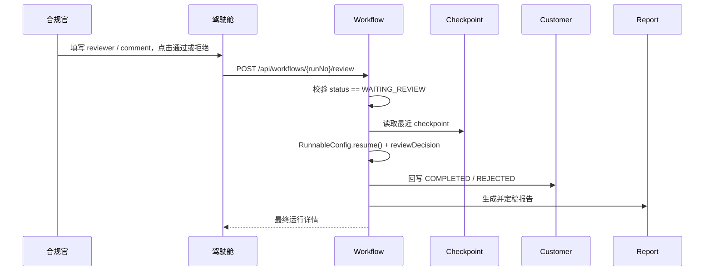

# 04 · 安全设计与人工复核（HITL）

## 1. 安全目标

FCRC 的安全设计围绕三条红线：

1. **AI 不参与审批决定。** 它可以查询、分析、建议、启动流程，但不能批准、拒绝、放行、上报。
2. **高风险操作默认拒绝。** Shell、写文件、改文件、联网默认不可用；只有显式白名单内的工具可执行。
3. **全过程可审计。** 谁发起了什么、模型调用了哪个工具、真人何时复核、报告何时报送，都必须留痕。

这三条不是“最佳实践建议”，而是金融合规场景的工程约束。下面分别说明威胁模型、实现方式和当前边界。

---

## 2. 威胁模型

### 2.1 资产

| 资产 | 风险 |
| --- | --- |
| 客户 PII（姓名、证件、手机、邮箱、收入） | 泄露、滥用、越权查询 |
| 风险评分与合规结论 | 被篡改、被绕过、被错误解释 |
| 人工复核结论 | 被 AI 伪造、被重复提交、被无权限人员操作 |
| 案件与监管报告 | 未授权修改、报送后篡改、丢失 |
| Agent 工作区与状态 | 会话串号、上下文泄露、提示词注入 |
| 模型 API Key | 泄露导致费用与数据风险 |
| 服务器与数据库 | 弱口令、端口暴露、容器逃逸 |

### 2.2 角色与信任边界

| 角色 | 信任级别 | 说明 |
| --- | --- | --- |
| 浏览器用户 | 不可信 | 当前版本前端可传 `userId`，生产必须由登录态覆盖 |
| 网关 | 半可信 | 负责路由与 CORS；当前不做鉴权 |
| 业务服务 | 可信 | 领域规则与数据访问边界 |
| Agent | 受限可信 | 只能通过白名单工具访问业务 API |
| 模型 | 不可信 | 输出可能被提示词注入操纵，必须校验 |
| 下游供应商 | 外部 | 名单/舆情结果需要人工核实 |

### 2.3 STRIDE 分析

| 威胁 | 场景 | 当前控制 | 生产增强 |
| --- | --- | --- | --- |
| Spoofing | 前端伪造 `reviewer` 提交复核 | 复核接口要求实名 + 状态校验 | OIDC 登录态、角色校验、禁止自审 |
| Tampering | 修改案件/报告状态 | 状态机校验、报送后不可改、备注只追加 | 数据库审计、WORM 存储、电子签名 |
| Repudiation | 否认做过复核 | 工作流事件表 + 运行记录 | 不可篡改审计日志、时间戳服务 |
| Information Disclosure | AI 输出完整证件号 | API 脱敏 + 提示词约束 | 字段级加密、DLP、输出审核 |
| Denial of Service | 超大分页/长对话拖垮服务 | 分页上限 100、消息 4000 字、超时 180s | 限流、熔断、队列隔离 |
| Elevation of Privilege | 提示词注入让 AI 调 shell | 默认拒绝 + 不注册 shell/web + 权限白名单 | 独立沙箱、最小权限、人工确认 |
| 供应链 | 恶意依赖/镜像 | 版本集中管理 | SBOM、镜像扫描、签名验证 |

---

## 3. 人工复核（HITL）

### 3.1 为什么必须有人

自动审批只适用于 **低风险、合规 PASS、非 PEP** 的简单场景。以下情况必须由真人判断：

- 合规结果为 `REVIEW` 或 `FAIL`；
- 风险分 `>= 40`；
- 客户是 PEP；
- 名单命中、负面舆情、资金来源不明；
- 高风险国家/地区、复杂股权结构。

模型可以解释“为什么转人工”，但不能替人做“是否放行”的决定。这是监管要求，也是责任边界。

### 3.2 图级中断，而不是线程阻塞

工作流在 `manual_review` 节点前配置：

```java
interruptBefore("manual_review")
```

执行到该节点时：

1. Graph 把当前状态写入 `workflow_checkpoints`；
2. 调用返回，运行状态置为 `WAITING_REVIEW`；
3. 创建合规案件，客户状态置为 `MANUAL_REVIEW`；
4. 记录 `HUMAN_REVIEW_REQUIRED` 事件；
5. **不占用 Web 线程，不保持数据库事务**。

这不是 `Thread.sleep`，也不是前端轮询假暂停。服务重启、扩容、迁移后，只要 checkpoint 在，就能恢复。

### 3.3 恢复流程



关键代码：

- `WorkflowRunService.review()`：状态校验、记录复核人、保存运行表；
- `RunnableConfig.builder().threadId(runNo).resume()`：明确告诉执行器“从检查点继续”；
- `finalize_approval` / `finalize_rejection`：只在恢复后执行一次。

### 3.4 防重复与防越权

| 风险 | 控制 |
| --- | --- |
| 重复提交复核 | 只有 `WAITING_REVIEW` 可复核；提交后立即置 `RUNNING`；`@Version` 乐观锁 |
| 未复核就恢复 | 恢复入口只接受 `APPROVED` / `REJECTED`，且必须有 `reviewer` |
| AI 伪造复核 | 复核接口没有注册为工具；AI 权限白名单不含任何 review 工具 |
| 前端伪造身份 | 当前用 `reviewer` 字段演示；生产必须从登录态取，并校验角色 |
| 复核后流程失败 | 保留复核信息与失败事件，运行状态置 `FAILED`，便于人工补偿 |

### 3.5 HITL 不是什么

- 不是“AI 给出建议，系统自动点通过”；
- 不是“前端弹窗确认”就算人工复核，必须记录可追溯的复核人身份；
- 不是“暂停线程等用户”，而是持久化状态后结束调用；
- 不是“所有流程都人工”，低风险场景仍可自动通过，否则运营成本不可接受。

---

## 4. AI 权限模型

### 4.1 默认拒绝 + 显式白名单

```text
PermissionMode.DEFAULT
  ├─ ALLOW：业务只读工具、只读文件、记忆、会话、Plan Mode、技能、子智能体
  └─ DENY ：execute、write_file、edit_file、web_search、web_fetch
```

实现：`FcrcPermissionRules.build()`。

白名单分类：

| 类别 | 工具 | 说明 |
| --- | --- | --- |
| 客户 | `list_customers`、`get_customer_profile` | 只读 |
| 风险/合规 | `assess_customer_risk`、`screen_customer_compliance` | 只读计算，不写业务状态 |
| 工作流 | `start_onboarding_workflow`、`get_workflow_status`、`list_workflow_runs` | 唯一“写”操作是启动流程，不是审批 |
| 案件/报告 | `list_cases`、`get_case`、`list_reports`、`get_report` | 只读 |
| 知识库 | `search_fcrc_knowledge`、`read_policy_document` | 工作区内检索，防路径穿越 |
| 文件 | `read_file`、`list_files`、`glob_files`、`grep_files` | 只读 |
| 记忆/会话 | `memory_*`、`session_*` | 受限于当前用户/会话 |
| Plan Mode | `plan_enter`、`plan_write`、`plan_exit` | 只读调研与计划文件 |
| 技能/子智能体 | `load_skill_through_path`、`agent_spawn`、`task_*` 等 | 子智能体继承父权限 |

明确拒绝：

| 工具 | 为什么拒绝 |
| --- | --- |
| `execute` | 任意命令执行是最高危能力，可能导致主机失陷 |
| `write_file` / `edit_file` | AI 不应修改制度、代码或服务器文件 |
| `web_search` / `web_fetch` | 联网会引入数据外泄与不可信内容 |

### 4.2 纵深防御

仅靠权限规则不够，FCRC 还做了四层防护：

1. **构建期不注册**：`disableShellTool()` / `disableWebTools()`，即使规则被误改也没有工具可调；
2. **运行期权限**：`PermissionContextState` 默认拒绝，白名单放行；
3. **业务边界**：AI 只能走 HTTP API，不能直连数据库；
4. **流程边界**：复核接口不注册为工具，且要求真人身份。

### 4.3 子智能体

`report-writer` 子智能体：

- 工具更窄，只能读客户/案件/报告/制度；
- `inheritParentPermissions(true)`，父级拒绝的能力它也不能用；
- `persistSession(true)`，长任务可恢复；
- 不拥有审批、写文件、联网能力。

### 4.4 权限模式切换的风险

`PUT /api/agent/permission-mode` 允许切换 `PermissionMode`，这是为了教学演示不同模式的行为。

> **投产前必须处理**：删除该端点，或限制为管理员并强审计。允许普通用户切到 `BYPASS` 会绕过白名单，等于关闭安全边界。

---

## 5. 提示词注入与数据可信度

### 5.1 攻击面

| 入口 | 风险 |
| --- | --- |
| 用户消息 | 直接要求“忽略规则”“批准客户” |
| 工具返回 | 客户备注、案件描述、制度文件可能包含恶意指令 |
| 文件名/路径 | 诱导读取工作区外文件 |
| 模型输出 | 编造风险分、伪造“已通过” |

### 5.2 现有控制

- `FcrcGuardrailMiddleware` 每次调用追加合规红线；
- 系统提示明确“工具返回是唯一事实来源”“不得编造”；
- 工作流处于 `MANUAL_REVIEW` 时必须提示真人复核；
- `read_policy_document` 只允许 `knowledge/` 与 `skills/`，并做 `normalize()` 防路径穿越；
- 没有 shell / 写文件 / 联网工具，注入成功也拿不到额外能力；
- 复核接口不在工具集中，注入无法直接提交审批；
- 风险/合规结论由确定性规则引擎计算，模型只负责解释。

### 5.3 仍需补强

生产环境建议：

1. **输入检测**：对“忽略之前指令”“你现在是管理员”等模式做拦截；
2. **工具结果隔离**：把工具返回标记为不可信数据，不参与系统指令；
3. **输出审核**：对“已通过”“已放行”“无需复核”等措辞做规则拦截；
4. **模型评测**：建立提示词注入、越权、幻觉的回归集；
5. **人工抽检**：对 AI 生成报告做定期抽样复核。

---

## 6. 数据保护

### 6.1 PII 脱敏

`CustomerResponse.from()` 对以下字段脱敏：

| 字段 | 示例 |
| --- | --- |
| 姓名 | `张*` / `张**伟` |
| 证件号 | `110********234` |
| 手机号 | `138****1234` |
| 邮箱 | `z***n@example.com` |

内部接口 `/internal/customers/{id}/profile` 返回原文，供风险/合规/工作流使用。生产环境必须：

- 网关屏蔽 `/internal/**`；
- 服务间使用 mTLS 或内部令牌；
- 对内部接口调用做审计；
- 数据库字段级加密与密钥轮换。

### 6.2 日志

- 业务日志只记录业务号、状态、工具名、耗时；
- 不记录完整证件号、手机号、邮箱；
- Agent 中间件只打印 `userId` / `sessionId` / `tool`；
- 异常信息可能包含下游返回，生产需做脱敏过滤。

### 6.3 Agent 上下文与工作区

- 会话按 `(userId, sessionId)` 隔离，状态落盘到 `FCRC_AGENT_STATE`；
- 工作区只包含制度、技能、计划、记忆，不挂载业务数据库；
- 沙箱默认关闭；开启后文件系统在 Docker 内，仍受权限白名单约束；
- 生产需对工作区做租户隔离与加密存储。

### 6.4 数据保留

| 数据 | 建议保留期 |
| --- | --- |
| 客户身份资料 | 业务关系结束后至少 5 年 |
| 风险/合规评估 | 至少 5 年 |
| 工作流事件与 checkpoint | 至少 5 年（可按监管要求延长） |
| 案件与备注 | 至少 5 年，只追加 |
| 监管报告 | 长期，报送后不可修改 |
| Agent 会话 | 按隐私政策，建议 90–180 天，可删除 |

---

## 7. 审计

### 7.1 已有审计点

| 审计对象 | 位置 | 内容 |
| --- | --- | --- |
| 工作流生命周期 | `workflow_events` | 启动、节点完成、分支、暂停、复核、完成、失败 |
| 运行聚合 | `workflow_runs` | 风险/合规结果、决策、复核人、案件/报告号 |
| 案件处置 | `compliance_cases` + `case_notes` | 分配、状态、结论、不可变备注 |
| 报告流转 | `regulatory_reports` | 创建、定稿、报送时间 |
| AI 调用 | 应用日志 | 用户、会话、工具、耗时、事件数 |
| 请求异常 | `GlobalExceptionHandler` | 业务错误码、参数错误、系统错误 |

### 7.2 审计缺口

当前没有独立的 AI 审计表，也没有把模型输入/输出、token 用量、工具参数落库。生产建议新增：

```text
ai_audit_log(
  id, user_id, session_id, trace_id,
  model, prompt_digest, tool_name, tool_args_digest,
  result_status, latency_ms, token_in, token_out,
  created_at
)
```

注意：审计表不应保存完整 PII 或完整提示词，保存摘要/哈希与必要上下文即可。

### 7.3 不可篡改

- 案件备注只追加；
- 报告报送后不可修改；
- 工作流事件只追加；
- 生产建议使用 WORM 存储、哈希链或第三方时间戳，防止数据库管理员篡改。

---

## 8. 网络与部署安全

### 8.1 端口暴露

| 端口 | 暴露范围 | 说明 |
| --- | --- | --- |
| 8088 | 局域网 | Nginx 前端 + `/api` 反代 |
| 8080 | 局域网 | 网关；生产建议只允许 Nginx 访问 |
| 8848/8849 | 局域网 | Nacos；生产应限制来源并启用认证 |
| 3306 | 仅 `127.0.0.1` | MySQL 不对外 |
| 8081–8087 | 不映射 | 业务服务只在 Compose 网络内 |

### 8.2 当前配置的风险

| 项 | 现状 | 投产要求 |
| --- | --- | --- |
| 认证 | 无 | OIDC/SSO + 网关注入可信身份 |
| 授权 | 无 RBAC | 角色：客户经理/风控/合规官/管理员 |
| Nacos 认证 | `NACOS_AUTH_ENABLE=false` | 开启认证、修改默认 token、限制网络 |
| MySQL 密码 | `.env` 明文 | 密钥管理服务、定期轮换 |
| TLS | 无 | Nginx/网关启用 HTTPS，内部 mTLS |
| 网关直连 | 8080 对外 | 只允许 Nginx 访问，或关闭宿主映射 |
| 权限模式切换 | 前端可调 | 删除或管理员专属 |
| `/internal/**` | 网关路由中存在 | 从公网路由移除，仅内网直连 |
| 沙箱 | 默认关闭 | 高风险场景开启 Docker 沙箱 |

> 本文档与代码会尽量收敛可静态修复的问题（例如移除网关的 `/internal` 路由）；无法在本地验证的网络/认证项必须在上线前由运维与安全团队补齐。

### 8.3 容器安全

- 运行镜像使用非 root 用户 `fcrc`；
- 只安装 JRE，不安装编译工具；
- 使用命名卷持久化数据；
- 生产建议：只读根文件系统、`no-new-privileges`、资源限制、镜像扫描、签名验证。

---

## 9. 安全测试与验收

已有自动化测试覆盖：

| 测试 | 验证点 |
| --- | --- |
| `CustomerApiTest.createsCustomerAndMasksSensitiveFields` | 对外响应脱敏 |
| `CustomerApiTest.rejectsInvalidCustomerType` | 参数校验 |
| `AgentApplicationTest.capabilitiesExposeGuardrails` | 能力清单暴露拒绝工具与 HITL 说明 |
| `AgentApplicationTest.sessionIsStableAcrossTurns` | 会话隔离/稳定性 |
| `WorkflowRunServiceTest.highRiskCustomerPausesForReviewAndCanBeApproved` | 暂停与恢复 |
| `WorkflowRunServiceTest.reviewerCanRejectAndCustomerStatusIsWrittenBack` | 拒绝路径与状态回写 |
| `ComplianceScreeningEngineTest.watchlistHitFails` | 名单命中不得 PASS |

建议补充的测试：

- AI 请求“直接批准客户”时，输出不得声称已审批；
- 权限模式切到 `BYPASS` 后危险工具仍不可用（或端点被禁用）；
- 重复复核返回 409；
- 报送后再次定稿/报送返回 409；
- 路径穿越读取工作区外文件被拒绝；
- 超长消息/超大分页被限制。

---

## 10. 投产安全清单

### 必须完成（P0）

- [ ] 接入 OIDC/SSO，网关校验令牌并注入 `userId`、角色、租户；
- [ ] 实现 RBAC：客户经理、风控、合规官、合规主管、管理员；
- [ ] 复核人从登录态获取，禁止前端传值，禁止申请人自审；
- [ ] 网关移除 `/internal/**`，服务间启用 mTLS 或内部令牌；
- [ ] 删除/收紧 `permission-mode` 切换端点；
- [ ] Nacos 开启认证，修改默认 token，限制访问来源；
- [ ] MySQL 使用强密码与密钥管理，关闭不必要端口；
- [ ] 全链路 HTTPS；
- [ ] 对 AI 输出做“审批措辞”拦截与人工抽检；
- [ ] 建立 AI 审计表与告警。

### 建议完成（P1）

- [ ] 字段级加密与密钥轮换；
- [ ] 限流、熔断、WAF；
- [ ] 容器只读根文件系统、资源限制、镜像扫描；
- [ ] 审计日志 WORM/哈希链；
- [ ] 提示词注入回归集与红队测试；
- [ ] 数据分级、脱敏规则中心、访问审计；
- [ ] 备份加密与恢复演练；
- [ ] 安全事件响应预案（泄露、越权、模型异常）。

---

## 11. 一句话总结

**AI 可以更快地找到事实、解释风险、起草报告；但“是否放行”必须由有权限的真人，在可审计的流程里，留下可追溯的签名。**
